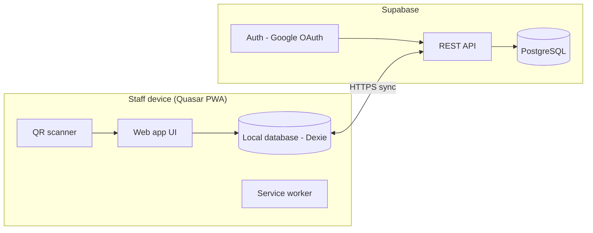

# QR Attendee

A QR code-based student attendance monitoring system for event premises. Students are registered once and receive a persistent QR code. An attendance clerk scans it on a phone, confirms the student's details, and records morning and afternoon check-in and check-out, even without an internet connection.

## Features

- Opens straight on the home screen. Guests can use every feature, with data saved on the device
- Optional sign-in with Google, or with an email and a password made for this app (the app never asks for a Google password): data is saved in the user's own account and is private to it. After sign-in, "Sync device data" in the menu sends the attendance recorded on the device as a guest to the signed-in account (it never asks by itself, so another clerk signing in is not prompted), then checks that every class, student and attendance record reached the account
- Manage classes and students, with each student's QR code viewable and downloadable in the app
- Import and export classes, students and attendance as .xlsx spreadsheets. The all-classes export holds the date and time of every scan, and importing it restores the attendance records
- Scan a student's QR code with the device camera, review the details, and confirm
- Morning and afternoon check-in and check-out, with a timestamp for every scan
- Works offline: after the first visit online, the app opens and records attendance with no internet (guest data is stored on the device; signed-in changes need a connection to save)
- Installable on phones and desktops (PWA)

## Tech stack

| Layer           | Technology                                    |
| --------------- | --------------------------------------------- |
| App             | Quasar (Vue 3, TypeScript), PWA mode          |
| Offline storage | IndexedDB via Dexie, Workbox service worker   |
| Authentication  | Google OAuth through Supabase Auth (optional) |
| Database        | Supabase (PostgreSQL) with row level security |
| Hosting         | To be decided                                 |

## Architecture



## Activity diagram


## Documentation

- [Business case](docs/business-case.md)
- [System requirements](docs/system-requirements.md)
- [Database design](docs/database.md) ([ERD source](docs/diagrams/erd.drawio), [SQL schema](supabase/schema.sql))

## Getting started

```bash
git clone https://github.com/Basher-kap/qr-attendance.git
cd qr-attendance
npm install
npm run dev
```

The app opens at `http://localhost:9000`.

### Email and password sign-in (Supabase settings)

In the Supabase dashboard, open Authentication and check:

- **Providers → Email** is enabled. Keep **Confirm email** on, so only the owner of an address can use it.
- **URL Configuration**: the site URL and redirect URLs include your Vercel domain and `http://localhost:9000`. Confirmation and reset links return there.
- Supabase links a Google login and an email login that share the same _confirmed_ address, so both open the same data. Without confirmation they would be separate accounts. Supabase configuration will be documented here once the backend is connected.

## Project structure

```
docs/        business case, requirements, diagrams
supabase/    database schema
src/         application source
```

## Status

- [x] Business case, requirements, diagrams and ERD
- [x] Project scaffold and GitHub repository
- [x] Supabase project and database schema
- [x] Guest mode with data saved on the device
- [x] Google sign-in and private cloud data per account
- [x] Manage classes and students
- [x] Scan flow
- [ ] Offline sync
- [x] Deployment (Vercel)

## Security

Security headers, a strict Content Security Policy, database isolation between accounts and automatic checks are built in. Run `npm run security:check` before every deploy (after `npm run build`), and see [docs/security.md](docs/security.md) for the checklist, the Supabase and Google settings to review, and the known limits.
