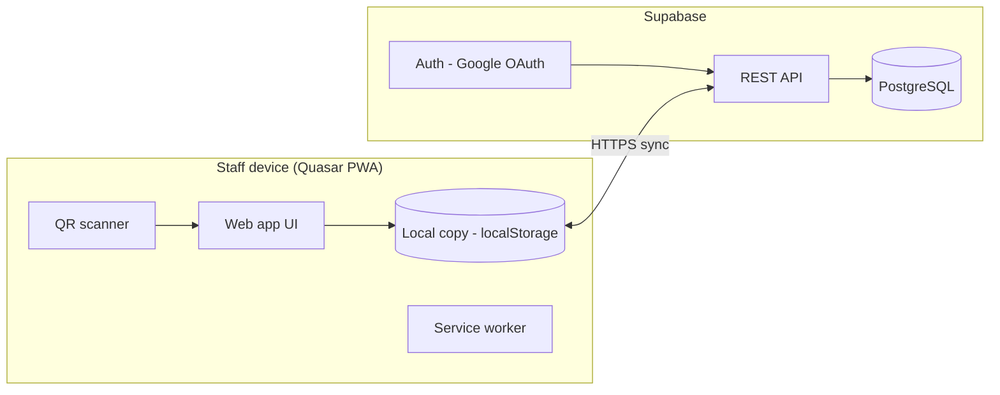

# QR Attendance

A QR code-based student attendance monitoring system for event premises. Students are registered once and receive a persistent QR code. An attendance clerk scans it on a phone, confirms the student's details, and records morning and afternoon check-in and check-out, even without an internet connection.

## Features

- Opens straight on the home screen. Guests can use every feature, with data saved on the device
- Optional Google sign-in. Each Google account has its own private classes, students and records in the cloud, visible only to that account. Several clerks share data by signing in with the same account on their phones
- A guest who signs in is offered to upload the data saved on the device to the account. Logging out goes back to the data on the device
- Manage classes and students, with each student's QR code viewable and downloadable in the app
- Import and export classes, students and attendance as .xlsx spreadsheets
- Scan a student's QR code with the device camera, review the details, and confirm
- Morning and afternoon check-in and check-out, with a timestamp for every scan
- Offline-first: changes are saved on the device and sent to the account when the connection returns
- Installable on phones and desktops (PWA)

## Tech stack

| Layer | Technology |
|---|---|
| App | Quasar (Vue 3, TypeScript), PWA mode |
| Offline storage | Working copy on the device (localStorage), Workbox service worker |
| Authentication | Google OAuth through Supabase Auth |
| Database | Supabase (PostgreSQL), one private dataset per account through row level security |
| Hosting | To be decided |

## Architecture



## How data is stored

| State | Where the data lives |
|---|---|
| Guest | Only on the device (localStorage). |
| Signed in | In the account's private cloud dataset, with a working copy on the device so scanning works offline. Changes are queued and sent when online. The app reads the account's data again on sign-in, when it comes back to the front, and when the connection returns. |
| Logged out | The device's guest data is shown again. The guest data is never changed while signed in. |

Uploading the device's guest data to an account matches classes by name and students by name within a class, like a spreadsheet import, so uploading twice does not create duplicates.

If two phones change the same thing at once, the last change wins. If the database refuses a change (for example a class with the same name created on two phones while offline), the app keeps the account's version and shows a notice.

## Activity diagram


## Documentation

- [Business case](docs/business-case.md)
- [System requirements](docs/system-requirements.md)
- [Database design](docs/database.md) ([ERD source](docs/diagrams/erd.drawio), [SQL schema](supabase/schema.sql))

## Getting started

```bash
git clone https://github.com/Basher-kap/qr-attendance.git
cd qr-attendance
npm install
npm run dev
```

The app opens at `http://localhost:9000`. Without Supabase settings it runs as a guest-only app.

### Connecting Supabase (optional, for sign-in and cloud data)

1. Create a Supabase project and run [`supabase/schema.sql`](supabase/schema.sql) in the SQL editor. If you ran an older version of the schema, run [`supabase/migrations/003_private_per_account.sql`](supabase/migrations/003_private_per_account.sql) instead. It stops if the old tables contain rows.
2. In Authentication, turn on the Google provider, and add the address the app runs on (for example `http://localhost:9000/`) to the allowed redirect URLs.
3. Copy `env.example` to `.env` and fill in `QCLI_SUPABASE_URL` and `QCLI_SUPABASE_KEY` (the publishable key only).

## Project structure

```
docs/        business case, requirements, diagrams
supabase/    database schema
src/         application source
```

## Status

- [x] Business case, requirements, diagrams and ERD
- [x] Project scaffold and GitHub repository
- [x] Supabase schema with private data per account
- [x] Guest mode with data saved on the device
- [x] Google sign-in, cloud data and upload of device data
- [x] Manage classes and students
- [x] Scan flow
- [x] Offline changes sent when the connection returns
- [ ] Deployment