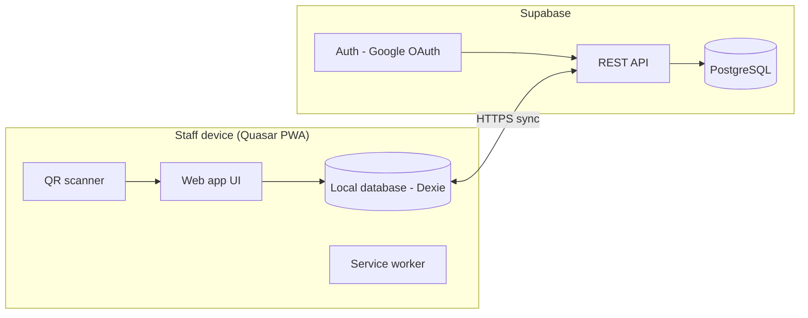
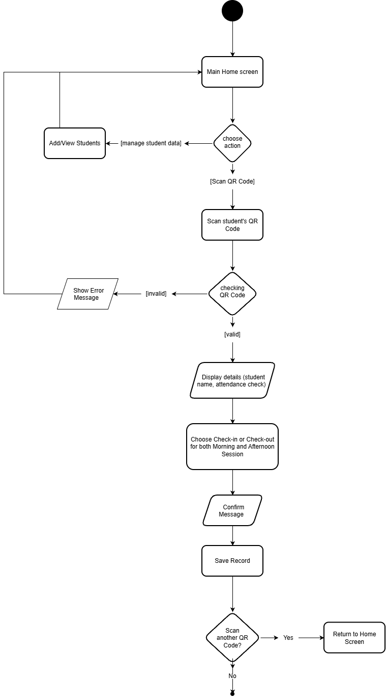

# QR Attendance

A QR code-based student attendance monitoring system for event premises. Students are registered once and receive a persistent QR code. An attendance clerk scans it on a phone, confirms the student's details, and records morning and afternoon check-in and check-out, even without an internet connection.

## Features

- Opens straight on the home screen. Guests can use every feature, with data saved on the device
- Optional Google sign-in: data is saved in the user's own account and is private to it. Device data can be uploaded after the first sign-in
- Manage classes and students, with each student's QR code viewable and downloadable in the app
- Import and export classes, students and attendance as .xlsx spreadsheets
- Scan a student's QR code with the device camera, review the details, and confirm
- Morning and afternoon check-in and check-out, with a timestamp for every scan
- Offline-first: the app opens without a connection. Changes are saved on the device and sent to the account when the connection returns, in the order they were made
- Installable on phones and desktops (PWA)

## Tech stack

| Layer | Technology |
|---|---|
| App | Quasar (Vue 3, TypeScript), PWA mode |
| Offline storage | Browser storage (localStorage) for the outbox and a copy of the account's data, plus a service worker (`service-worker/sw.template.js`) that caches the app |
| Authentication | Google OAuth through Supabase Auth (optional) |
| Database | Supabase (PostgreSQL) with row level security |
| Hosting | To be decided |

## Architecture



## Activity diagram



## Documentation

- [Business case](docs/business-case.md)
- [System requirements](docs/system-requirements.md)
- [Database design](docs/database.md) ([ERD source](docs/diagrams/erd.drawio), [SQL schema](supabase/schema.sql))

## Getting started

```bash
git clone https://github.com/Basher-kap/qr-attendance.git
cd qr-attendance
npm install
npm run dev
```

The app opens at `http://localhost:9000`. Supabase configuration will be documented here once the backend is connected.

## Offline use

- A service worker keeps the whole app on the device after the first visit, so it opens without a connection. It is generated during `npm run build` and only runs in the built app, not in `npm run dev`. A new release is downloaded in the background and applied when the user taps **Update now** (or after every tab is closed).
- Signed in: every change is stored in an outbox on the device first, then sent to Supabase in order. Without a connection the outbox waits and is retried when the connection returns, when the app comes back to the front, and every 15 seconds. The header shows the state (cloud, spinning arrows, or cloud with a line) and how many changes are waiting.
- A copy of the account's data is kept on the device so it opens offline. It is removed on log out. Changes still waiting stay on the device and are sent the next time the same account signs in.
- The account must be opened once with a connection on each device before it can be used offline.
- Changes the server refuses for good (for example a duplicate class name) are dropped and reported, and **Reload data** shows the account's real data again.
- Sending a change twice is harmless: classes and students are added with "do nothing if it exists", and attendance records are unique per student, day, session and type.

## Project structure

```
docs/        business case, requirements, diagrams
supabase/    database schema
src/         application source
service-worker/  template of the offline service worker (filled in by the build)
```

## Status

- [x] Business case, requirements, diagrams and ERD
- [x] Project scaffold and GitHub repository
- [x] Supabase project and database schema
- [x] Guest mode with data saved on the device
- [x] Google sign-in and private cloud data per account
- [x] Manage classes and students
- [x] Scan flow
- [x] Offline sync
- [x] Deployment (Vercel)