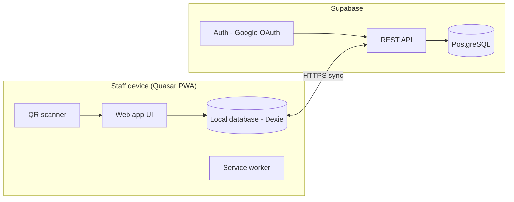
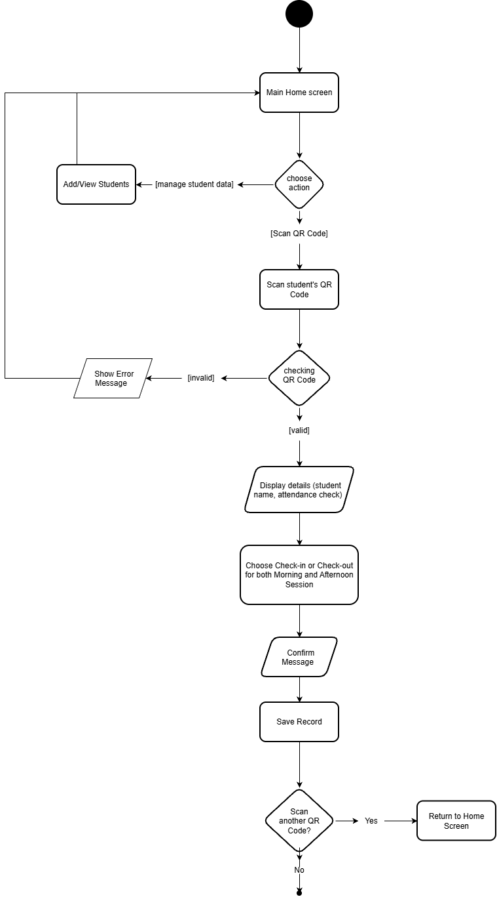

# QR Attendance

A QR code-based student attendance monitoring system for event premises. Students are registered once and receive a persistent QR code. An attendance clerk scans it on a phone, confirms the student's details, and records morning and afternoon check-in and check-out, even without an internet connection.

## Features

- Opens straight on the home screen. Guests can use every feature, with data saved on the device
- Optional Google sign-in to retrieve and save data in the cloud (in progress)
- Manage classes and students, with each student's QR code viewable and downloadable in the app
- Import and export classes, students and attendance as .xlsx spreadsheets
- Scan a student's QR code with the device camera, review the details, and confirm
- Morning and afternoon check-in and check-out, with a timestamp for every scan
- Offline-first: scans are saved on the device and synced when the connection returns
- Installable on phones and desktops (PWA)

## Tech stack

| Layer | Technology |
|---|---|
| App | Quasar (Vue 3, TypeScript), PWA mode |
| Offline storage | IndexedDB via Dexie, Workbox service worker |
| Authentication | Google OAuth through Supabase Auth |
| Database | Supabase (PostgreSQL) with row level security |
| Hosting | To be decided |

## Architecture



## Activity diagram



## Documentation

- [Business case](docs/business-case.md)
- [System requirements](docs/system-requirements.md)
- [Database design](docs/database.md) ([ERD source](docs/diagrams/erd.drawio), [SQL schema](supabase/schema.sql))

## Getting started

```bash
git clone https://github.com/Basher-kap/qr-attendance.git
cd qr-attendance
npm install
npm run dev
```

The app opens at `http://localhost:9000`. Supabase configuration will be documented here once the backend is connected.

## Project structure

```
docs/        business case, requirements, diagrams
supabase/    database schema
src/         application source
```

## Status

- [x] Business case, requirements, diagrams and ERD
- [x] Project scaffold and GitHub repository
- [ ] Supabase project and database schema
- [x] Guest mode with data saved on the device
- [ ] Google sign-in and cloud data
- [ ] Manage classes and students
- [ ] Scan flow
- [ ] Offline sync
- [ ] Deployment