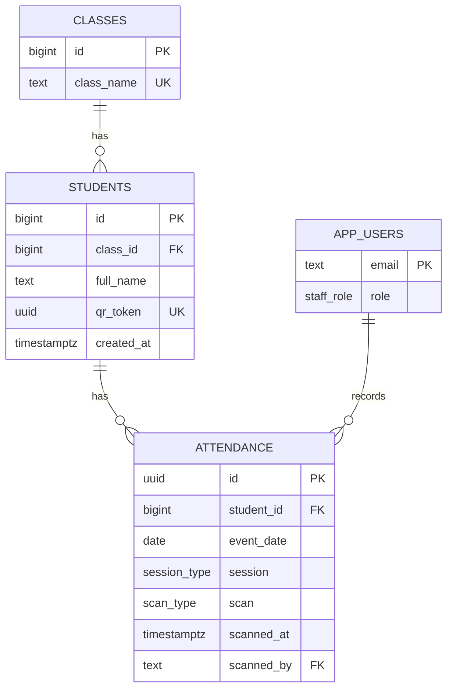

# Database Design

The schema is in [`supabase/schema.sql`](../supabase/schema.sql). The editable ERD is in [`diagrams/erd.drawio`](diagrams/erd.drawio).

## Notes

- `qr_token` is the value encoded in each student's QR code. The app draws the QR image from it, so no image is stored.
- `attendance` holds one row per check-in or check-out. A unique rule on student, date, session and scan type prevents duplicates.
- `app_users` is the allow-list of Google accounts and their roles.
