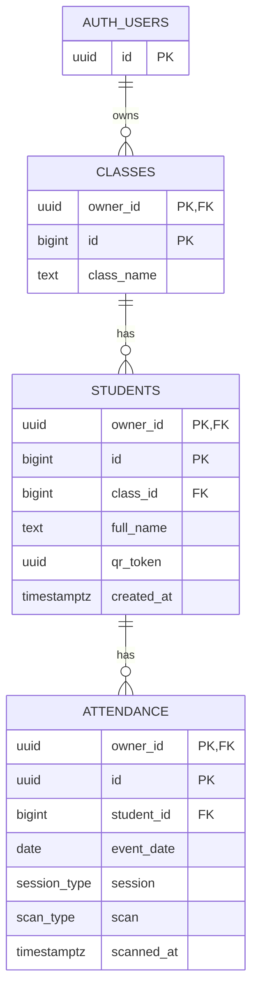

# Database Design

The schema is in [`supabase/schema.sql`](../supabase/schema.sql). The editable ERD is in [`diagrams/erd.drawio`](diagrams/erd.drawio).

## Notes

- Every row belongs to one Google account (`owner_id`, from `auth.users`), and row level security lets an account read and write only its own rows. Several clerks share data by signing in with the same account. There is no allow-list: any Google account can sign in and gets its own empty dataset. (`auth_users` in the diagram is Supabase's built-in `auth.users` table.)
- Ids are made on the device, not by the database, so changes made offline can be sent later and retried safely. An id only has to be unique within one account, so the primary keys are `(owner_id, id)`. Foreign keys include `owner_id` too, so a row can never point at another account's class or student.
- Class names are unique per account, ignoring upper and lower case. `(owner_id, qr_token)` is unique per account.
- `qr_token` is the value encoded in each student's QR code. The app draws the QR image from it, so no image is stored.
- `attendance` holds one row per check-in or check-out. A unique rule on account, student, date, session and scan type prevents duplicates.
- A class that still has students cannot be deleted. Deleting a student deletes their attendance. Deleting an account deletes all of its data.
