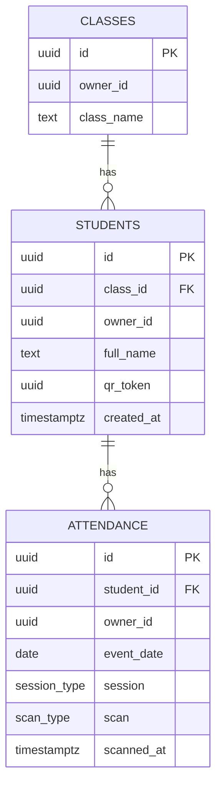

# Database Design

The schema is in [`supabase/schema.sql`](../supabase/schema.sql). The editable ERD is in [`diagrams/erd.drawio`](diagrams/erd.drawio).

Every row belongs to the Google account that created it (`owner_id`), and row level security shows each account only its own rows. Guests (not signed in) never reach the database: their data is saved on the device.

## Notes

- `owner_id` is the signed-in account (Supabase Auth). It is filled in automatically, and the access rules compare it with `auth.uid()`.
- Ids are `uuid` values created on the device, so data saved as a guest can be uploaded unchanged and a retried save cannot create duplicates.
- `class_name` is unique per account, and `qr_token` is unique per account.
- `qr_token` is the value encoded in each student's QR code. The app draws the QR image from it, so no image is stored.
- `attendance` holds one row per check-in or check-out. A unique rule on student, date, session and scan type prevents duplicates.
- Shared team data (an allow-list of accounts) and a student role are on hold for later.